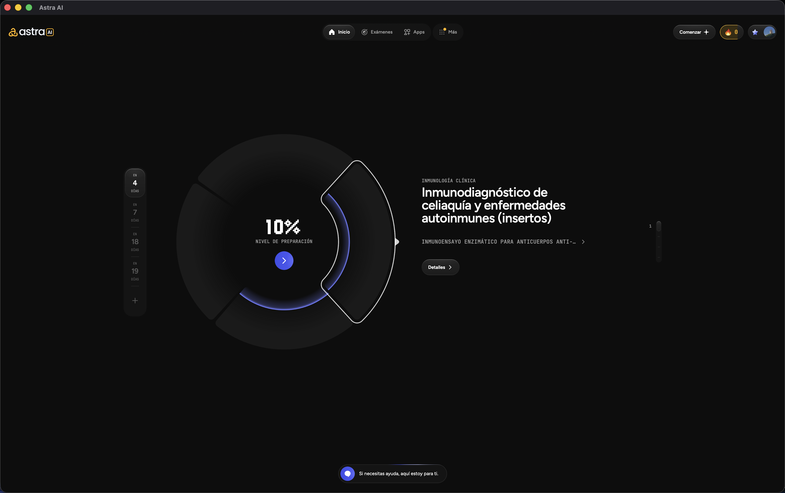
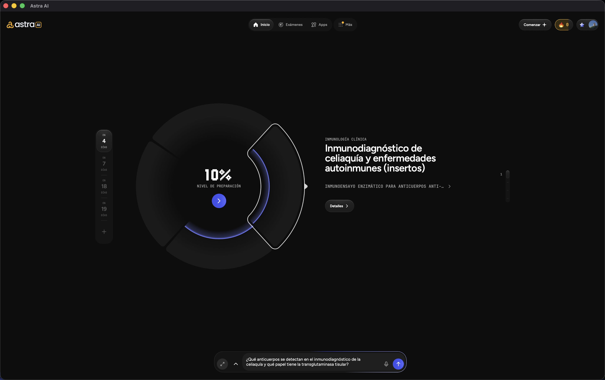
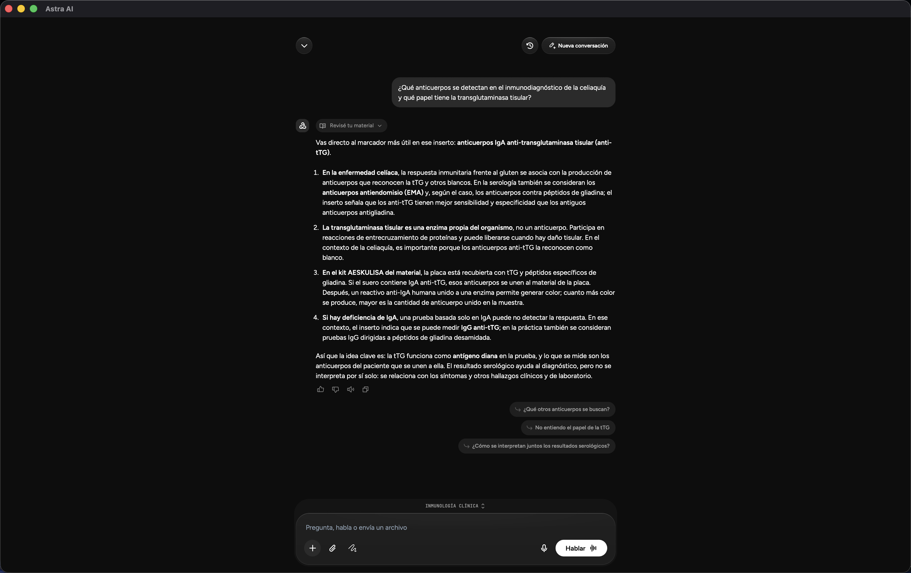

# Demostración — caso real (antes / después)

Tarea auténtica de la disciplina (inmunología clínica): verificar con la app de
estudio **Astra AI** un contenido del ramo — *inmunodiagnóstico de la celiaquía* —
usando el MCP `astra-ai` desde opencode.

## Qué se pidió a la IA

> "Pregúntale a Astra: ¿Qué anticuerpos se detectan en el inmunodiagnóstico de
> la celiaquía y qué papel tiene la transglutaminasa tisular?"

## Qué ejecutó el MCP sobre la aplicación real

1. **`astra_abrir`** — abrió Astra AI y la trajo al frente.
2. **`astra_ver`** — capturó la ventana y leyó la pantalla por OCR
   (verifica el estado y localiza el campo de texto).
3. **`astra_preguntar`** — hizo clic en el campo de entrada, pegó la pregunta
   (portapapeles + `Cmd+V`), presionó Return y esperó la respuesta.
4. **`astra_ver`** — capturó la pantalla final y devolvió la respuesta por OCR.

Técnica: el helper Swift (`helper/astra-helper.swift`) localiza la ventana con
`CGWindowList`, envía clics y teclas nativos con `CGEvent`, captura con
`screencapture` recortada a la ventana y lee con el framework **Vision** de macOS.

## Antes (pantalla de inicio con el material del ramo)

## Durante (pregunta escrita en el campo de Astra)

## Después (respuesta de Astra, leída por OCR)

### Respuesta obtenida (resumen del OCR)

> El anticuerpo serológico de primera línea es la **IgA anti-transglutaminasa
> tisular (anti-tTG)**; también se consideran los **antiendomisio (EMA)** y los
> anticuerpos contra **péptidos de gliadina**, y el material señala que los
> anti-tTG tienen mejor sensibilidad y especificidad. La **transglutaminasa
> tisular no es un anticuerpo sino una enzima propia** que actúa como antígeno
> diana en la prueba (en el kit AESKULISA la placa está recubierta con tTG). En
> deficiencia de IgA se mide **IgG anti-tTG**. El resultado serológico se
> interpreta junto con los síntomas y otros hallazgos clínicos.

La respuesta fue contrastada por el estudiante con su bibliografía y resultó
consistente.

## Reproducir la demostración

1. Conceder permisos de Accesibilidad y Grabación de pantalla (ver README).
2. Abrir Astra AI e iniciar sesión.
3. En opencode: *"Pregúntale a Astra: [pregunta] y muéstrame la respuesta"*.
4. El flujo completo queda registrado con capturas en `data/capturas/`.

Vídeo breve disponible junto a los entregables (grabación de pantalla del mismo
flujo, ~1 minuto).
